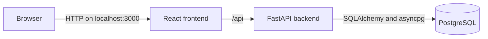

# CyberSentinel

CyberSentinel is a defensive, cross-platform threat detection and security
monitoring project for systems that you own or are authorized to monitor. It
is being built as a staged Blue Team and SOC portfolio project.

> **Current status:** v0.1.0, Stage 1 — Project Foundation. The repository
> currently provides the application skeleton, health reporting, and the
> containerized development stack. Threat collection, detection, alerting,
> authentication, and incident workflows are not part of this stage.

## Stage 1 capabilities

- FastAPI service with separate liveness and database-readiness checks.
- PostgreSQL connected through the private Compose network.
- React, TypeScript, and Vite frontend built from a committed `pnpm-lock.yaml`.
- Container health checks and dependency-aware startup.
- Localhost-only host bindings for the frontend and API.
- Persistent PostgreSQL data in a named Docker volume.
- Environment-based configuration with no committed runtime secrets.

## Architecture



The frontend and API are reachable from the host. PostgreSQL is intentionally
not published to the host and is reachable only from the backend container.
See [docs/architecture.md](docs/architecture.md) for trust boundaries and
runtime details.

## Requirements

- Docker Engine with Docker Compose 2 or newer, or Docker Desktop with Compose.
- Free local ports 3000 and 8000, unless changed in `.env`.

Local Python, Node.js, pnpm, and PostgreSQL installations are not required for
the containerized workflow.

## Quick start

1. Create the local environment file:

   PowerShell:

   ```powershell
   Copy-Item .env.example .env
   ```

   Linux or macOS:

   ```bash
   cp .env.example .env
   ```

2. Set `POSTGRES_PASSWORD` in `.env` to a long, randomly generated value. The
   stack deliberately refuses to start when this value is missing.

3. Build and start the system:

   ```bash
   docker compose up --build
   ```

When all services are healthy, open:

- Frontend: <http://127.0.0.1:3000>
- API documentation: <http://127.0.0.1:8000/docs>
- API liveness: <http://127.0.0.1:8000/api/health/live>
- API readiness: <http://127.0.0.1:8000/api/health/ready>

Stop the stack without deleting database data:

```bash
docker compose down
```

Running `docker compose down --volumes` also deletes the local PostgreSQL
volume and all data stored in it.

## Validation

After creating `.env`, validate the rendered Compose configuration before
starting containers:

```bash
docker compose config --quiet
docker compose up --build --detach
docker compose ps
```

Expected behavior:

- `live` returns HTTP 200 while the API process is running.
- `ready` returns HTTP 200 only when PostgreSQL answers a real connectivity
  check; it returns HTTP 503 without exposing connection details when the
  database is unavailable.
- The frontend reports the real API status rather than simulated SOC data.

Run backend tests and static checks from an isolated Python 3.12 environment:

```powershell
py -3.12 -m venv .venv
& .\.venv\Scripts\python.exe -m pip install -c backend\constraints.txt -e ".\backend[dev]"
Push-Location backend
& ..\.venv\Scripts\python.exe -m pytest
& ..\.venv\Scripts\python.exe -m ruff check .
& ..\.venv\Scripts\python.exe -m mypy
Pop-Location
```

Run the frontend frozen install and quality gates:

```powershell
Push-Location frontend
pnpm install --frozen-lockfile
pnpm lint
pnpm typecheck
pnpm build
Pop-Location
```

Run the repository-level security and configuration checks:

```powershell
& .\.venv\Scripts\python.exe -m pytest tests\test_foundation_configuration.py
& .\.venv\Scripts\python.exe -m ruff check tests
```

Run the black-box suite in healthy and database-outage phases. Every phase has
its own exit code, and the `finally` block restores PostgreSQL even when a test
fails:

```powershell
$healthyExitCode = -1
$stopExitCode = -1
$outageExitCode = -1
$startExitCode = -1
$waitExitCode = -1
$env:CYBERSENTINEL_RUN_STACK_TESTS = "1"

try {
    & .\.venv\Scripts\python.exe -m pytest tests\integration
    $healthyExitCode = $LASTEXITCODE

    if ($healthyExitCode -eq 0) {
        docker compose stop postgres
        $stopExitCode = $LASTEXITCODE
    }

    if ($stopExitCode -eq 0) {
        $env:CYBERSENTINEL_EXPECT_DATABASE_UNAVAILABLE = "1"
        & .\.venv\Scripts\python.exe -m pytest tests\integration
        $outageExitCode = $LASTEXITCODE
    }
}
finally {
    Remove-Item Env:CYBERSENTINEL_EXPECT_DATABASE_UNAVAILABLE -ErrorAction SilentlyContinue
    docker compose start postgres
    $startExitCode = $LASTEXITCODE

    if ($startExitCode -eq 0) {
        docker compose up --detach --wait --wait-timeout 120
        $waitExitCode = $LASTEXITCODE
    }

    Remove-Item Env:CYBERSENTINEL_RUN_STACK_TESTS -ErrorAction SilentlyContinue
}

if (
    $healthyExitCode -ne 0 -or
    $stopExitCode -ne 0 -or
    $outageExitCode -ne 0 -or
    $startExitCode -ne 0 -or
    $waitExitCode -ne 0
) {
    throw "Black-box validation failed: healthy=$healthyExitCode stop=$stopExitCode outage=$outageExitCode start=$startExitCode wait=$waitExitCode"
}
```

On Linux, use `.venv/bin/python -m pytest tests/integration` after exporting
the same variables and restore PostgreSQL with Compose in a shell cleanup
trap. The suite checks the built frontend, health contracts through the direct
backend port and Nginx, failure sanitization, HTTP error contracts, Nginx
security headers, and the runtime absence of a PostgreSQL host-port binding.
It is skipped unless explicitly enabled for a running stack.

## Project layout

```text
backend/             FastAPI service
frontend/            React and Vite application
agent/               Reserved for the Stage 4 endpoint agent
docker/              Shared container assets when they become necessary
docs/                 Architecture and implementation documentation
scripts/              Cross-project operational scripts
tests/                Repository configuration and cross-service tests
.github/workflows/    CI workflows introduced in Stage 24
docker-compose.yml    Local three-service stack
```

Reserved directories contain no placeholder implementation and do not imply
that their future features are available.

## Security posture for this stage

- `.env` and common private-key formats are ignored by Git.
- Runtime credentials are injected through environment variables.
- PostgreSQL has no host port mapping.
- Host-facing development ports bind to loopback by default.
- Health responses expose state only, never credentials, DSNs, or raw database
  exceptions.
- Frontend build-time variables are treated as public and must never contain
  secrets.

This project is defensive software. It must only be used on systems and data
that you own or are explicitly authorized to monitor.

## Implementation roadmap

Development follows strict stage gates: build, run, test, inspect errors,
review structure and security, and only then proceed. The ordered plan is in
[docs/implementation-plan.md](docs/implementation-plan.md).
