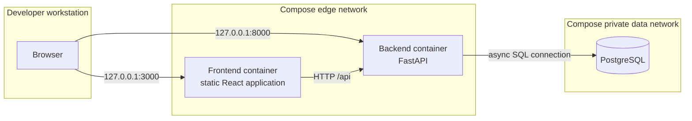
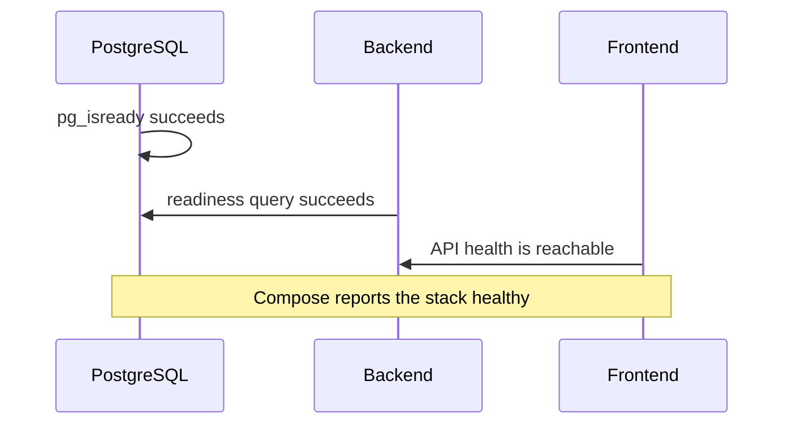

# CyberSentinel Architecture

## Scope

This document describes the Stage 1 foundation. It deliberately excludes
authentication, users, devices, events, alerts, agent ingestion, detection
rules, and all monitoring collectors. Those capabilities are introduced only
after their stage-specific models, tests, and security controls exist.

## Design goals

- Establish one runnable vertical path from browser to API to PostgreSQL.
- Keep service boundaries suitable for later agent and detection components.
- Make service health observable without exposing sensitive configuration.
- Provide secure local defaults and reviewed application dependency locks.
- Avoid speculative abstractions before domain behavior exists.

## Runtime view

The backend joins both networks. PostgreSQL joins only the private data
network. The database has no host port mapping. The frontend has no direct
database access.

## Components

### Backend

The backend is a typed FastAPI application. Configuration is read from
environment variables and validated at startup. Its Stage 1 database adapter
uses SQLAlchemy 2 with the asynchronous PostgreSQL driver and performs only a
non-mutating readiness query.

The application does not create tables automatically. Database models and
Alembic migrations are owned by Stage 2, which prevents development startup
logic from becoming an undocumented migration mechanism.

### Frontend

The frontend is a React and TypeScript application built by Vite. pnpm is the
package manager, and `pnpm-lock.yaml` is the authoritative dependency lock.
Container builds must use the frozen lockfile.

The Stage 1 interface may display application and database health obtained
from the API. It must not display invented alerts, incidents, devices, risk
scores, or threat metrics.

The browser uses relative `/api` URLs. The local Vite server and the container
web server proxy that path to FastAPI, avoiding a permissive cross-origin
policy.

### PostgreSQL

PostgreSQL is the only persistent Stage 1 service. Its named volume survives a
normal `docker compose down`. Credentials are supplied at runtime and the
Compose configuration refuses to start when the password is unset.

## Health contract

### `GET /api/health/live`

Liveness answers whether the FastAPI process can serve requests. It performs
no network or database operation. A healthy response returns HTTP 200 with a
small stable payload.

### `GET /api/health/ready`

Readiness executes a bounded, non-mutating database connectivity check such as
`SELECT 1`.

- HTTP 200 means the API and PostgreSQL are ready.
- HTTP 503 means a dependency is unavailable.
- The response contains only normalized check states.
- Full diagnostic exceptions may be logged safely, but credentials, tokens,
  passwords, and complete connection strings must be redacted.

The backend container health check uses readiness so dependent containers are
not reported healthy before the database path works. Liveness remains
available to distinguish an API process failure from a database outage.

## Startup and shutdown

Compose health conditions prevent the usual startup race. Each application
must still handle dependency loss after startup: readiness changes to 503 and
the process remains alive. On shutdown, the backend disposes its database pool
and containers receive a normal termination signal.

## Configuration and secrets

`.env.example` documents required variable names but contains no operational
secret. Developers create an ignored `.env` and provide a unique local
password. The backend receives separate database fields rather than a
shell-composed URL, allowing the application to encode special characters
correctly.

No value exposed through a `VITE_` prefix is secret; Vite embeds those values
in browser assets. Frontend-to-backend routing therefore uses a relative path
and requires no credential in the frontend build.

The backend container resolves its production graph through
`backend/constraints.txt`. This pins package versions for the supported
CPython 3.12 Debian image while `pyproject.toml` remains the authoritative list
of direct dependencies. Base images use explicit patch and distribution tags;
immutable image digests and artifact attestations belong to the
release-hardening work.

## Trust boundaries

1. **Host to frontend/API:** local development ports bind to `127.0.0.1` by
   default. Deliberate remote exposure requires an explicit configuration
   change and appropriate TLS, authentication, and reverse-proxy controls.
2. **Frontend to backend:** only HTTP API traffic crosses this boundary. The
   frontend never receives database credentials.
3. **Backend to database:** only the backend joins the data network. SQL is
   issued through the database library; later domain access uses SQLAlchemy
   models and migrations.
4. **Build boundary:** service-scoped build contexts, ignore rules, and
   explicit Dockerfile copy lists keep the root environment file, Git
   metadata, local caches, and generated dependencies out of image layers.

## Evolution constraints

- New domain tables require Alembic migrations beginning in Stage 2.
- Protected resources wait for authentication and role enforcement in Stage 3.
- Agent endpoints wait for device authentication in Stage 4.
- Collectors normalize events but never create alerts directly.
- Detection rules remain separated from collection and persist alerts through
  the backend service layer.
- Redis, queues, task workers, Kafka, and search clusters are intentionally
  deferred until a measured need exists.
